# ex_actor 框架运行流程图

```mermaid
flowchart TB
    %% ============ 1. 初始化阶段 ============
    subgraph Init["阶段一：初始化"]
        direction TB
        A1[ex_actor::Init<br/>传入 thread_pool_size]
        A2[创建 WorkSharingThreadPool<br/>或 WorkStealingThreadPool]
        A3[创建 SchedulerUnion<br/>支持多调度器]
        A4[初始化 ActorRegistryBackend]
        A1 --> A2 --> A3 --> A4
    end

    %% ============ 2. Actor 创建阶段 ============
    subgraph Create["阶段二：Actor 创建"]
        direction TB
        B1[ex_actor::Spawn&lt;UserClass&gt;<br/>或 CreateActor]
        B2{是本地 Actor<br/>还是远程 Actor?}
        B1 --> B2

        %% 本地创建分支
        B3[生成唯一 ActorId]
        B4[创建 Actor&lt;UserClass&gt; 实例]
        B5[创建 ActorRef&lt;UserClass&gt;<br/>返回给调用者]

        %% 远程创建分支
        B6[序列化创建参数<br/>ActorCreationArgs]
        B7[通过网络发送<br/>kActorCreationRequest]
        B8[远程节点创建 Actor]
        B9[返回 ActorRef<br/>包含远程节点信息]

        B2 -->|本地| B3 --> B4 --> B5
        B2 -->|远程| B6 --> B7 --> B8 --> B9
    end

    %% ============ 3. 消息发送与处理 ============
    subgraph Message["阶段三：消息发送与处理"]
        direction TB

        %% 消息发送入口
        C1[ActorRef.Send&lt;Method&gt;<br/>args...]
        C2{目标 Actor<br/>是本地还是远程?}

        %% 本地发送
        C3[ActorRef.SendLocal<br/>直接调用方法]
        C4[创建 ActorMessage<br/>入队到 Mailbox]
        C5[pending_message_count<br/>原子计数 +1]
        C6[TryActivate<br/>CAS 检查]
        C7{是否需要激活?}

        %% 远程发送
        C8[序列化方法调用<br/>ActorMethodCallArgs]
        C9[通过网络发送<br/>kActorMethodCallRequest]
        C10[等待响应]

        C1 --> C2
        C2 -->|本地| C3 --> C4 --> C5 --> C6 --> C7
        C2 -->|远程| C8 --> C9 --> C10

        %% 调度与执行
        C11[scheduler-&gt;Schedule<br/>将 Actor 调度到线程池]
        C12[PullMailboxAndRun<br/>拉取并执行消息]
        C13[TryPop 从 Mailbox<br/>取出消息]
        C14{是否有消息?}
        C15[Execute 执行消息]
        C16[message_executed++]
        C17{达到单次激活<br/>最大消息数?}
        C18[退出本次调度]
        C19[还有待处理<br/>消息?]

        C7 -->|是| C11 --> C12 --> C13 --> C14
        C7 -->|否| C20[已有其他调度]
        C10 -.-> C4

        C14 -->|有| C15 --> C16 --> C17
        C14 -->|无| C18
        C17 -->|否| C13
        C17 -->|是| C18
        C18 --> C19
        C19 -->|是| C6
        C19 -->|否| C21[保持休眠]
    end

    %% ============ 4. Actor 销毁阶段 ============
    subgraph Destroy["阶段四：Actor 销毁"]
        direction TB
        D1[ex_actor::DestroyActor<br/>传入 ActorRef]
        D2[设置<br/>pending_to_be_destroyed]
        D3[等待 async_scope<br/>on_empty]
        D4[重置 user_class_instance<br/>清空 Mailbox]
        D5[Actor 销毁完成]

        D1 --> D2 --> D3 --> D4 --> D5
    end

    %% ============ 5. 框架关闭阶段 ============
    subgraph Shutdown["阶段五：框架关闭"]
        direction TB
        E1[ex_actor::Shutdown]
        E2[AsyncDestroyAllActors<br/>销毁所有 Actor]
        E3[停止所有调度器]
        E4[清理资源]

        E1 --> E2 --> E3 --> E4
    end

    %% 连接各阶段
    Init --> Create
    Create --> Message
    Message --> Destroy
    Destroy --> Shutdown

    %% 样式
    style Init fill:#e1f5fe,stroke:#01579b
    style Create fill:#fff3e0,stroke:#e65100
    style Message fill:#e8f5e9,stroke:#2e7d32
    style Destroy fill:#fce4ec,stroke:#c2185b
    style Shutdown fill:#f3e5f5,stroke:#7b1fa2
```

---

# Coroutine 调度运行详解

## 整体架构

ex_actor 的 coroutine 调度基于 **std::execution** (P2300) 的 sender/receiver 模式，结合 **exec::task** 实现异步 coroutine。

## 核心组件

| 组件 | 说明 |
|------|------|
| **exec::task<T>** | Google 的异步 coroutine 库，提供 `co_await` 支持 |
| **StdExecSchedulerForActorMessageSubmission** | 将消息提交到 Actor Mailbox 的调度器 |
| **ActorMessageSubmissionOperation** | 封装待执行操作的消息 |
| **WrapSenderWithInlineScheduler** | 为 sender 添加内联调度器作为 fallback |

## Coroutine 调度流程图

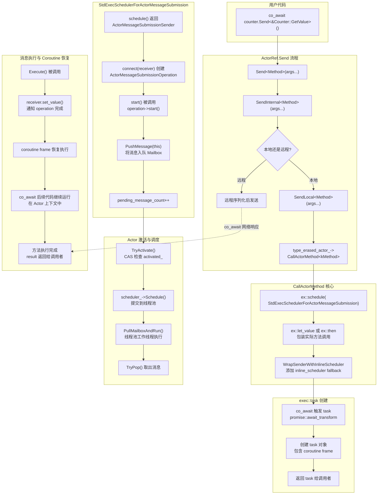

## 详细步骤说明

### 步骤 1：用户发起调用

```cpp
// 用户代码
auto result = co_await counter.Send<&Counter::GetValue>();
```

### 步骤 2：Send → SendInternal → SendLocal

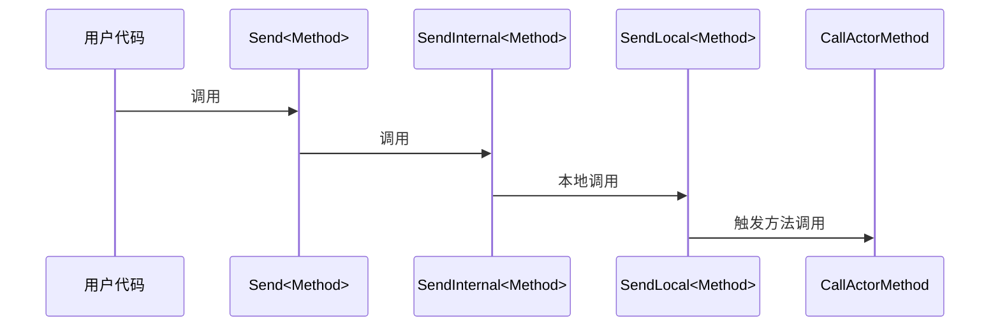

### 步骤 3：构建 Sender 链

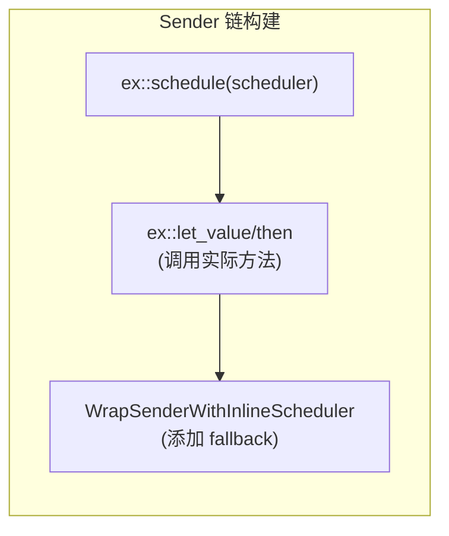

**关键代码**：
```cpp
auto start = ex::schedule(StdExecSchedulerForActorMessageSubmission(this));
return std::move(start) | ex::let_value([user_class_instance, args_tuple...]() mutable {
    return std::apply([user_class_instance](auto&&... args) {
        return (user_class_instance->*kMethod)(std::move(args)...);
    }, std::move(args_tuple));
});
```

### 步骤 4：co_await 触发 Task 创建

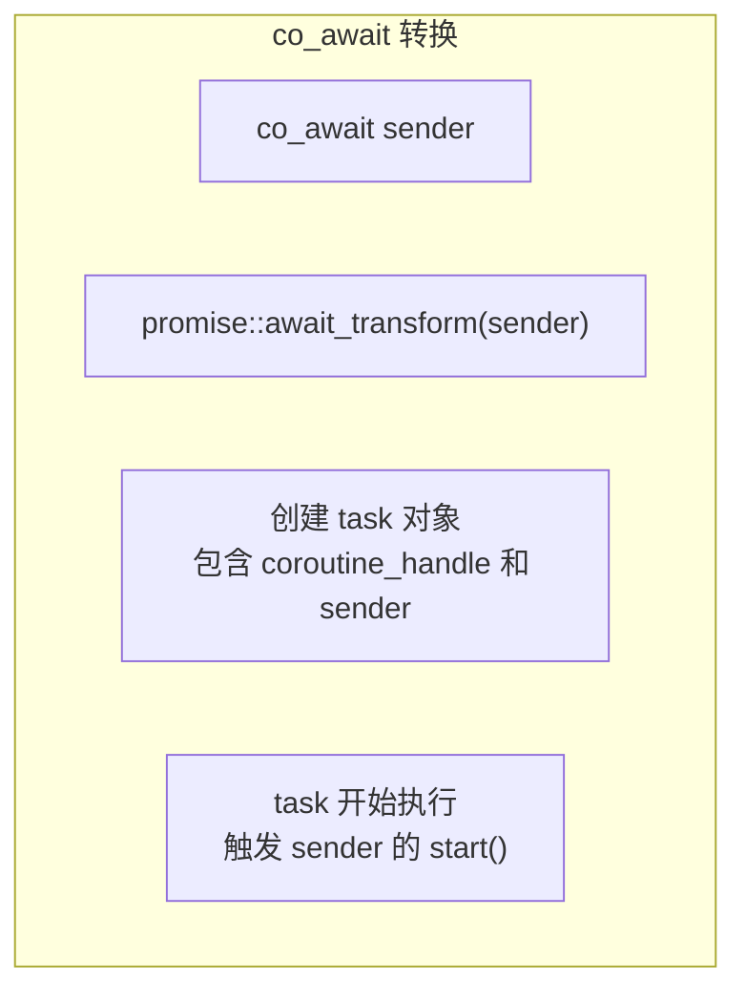

### 步骤 5：消息入队 Mailbox

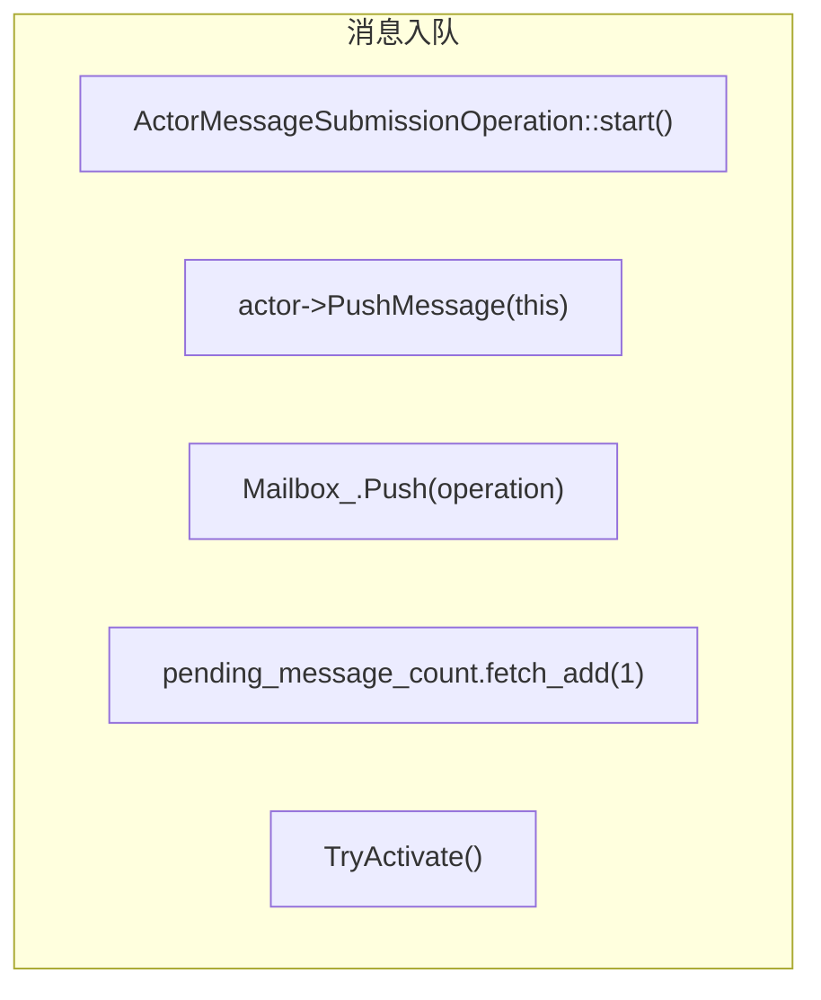

### 步骤 6：Actor 激活与调度

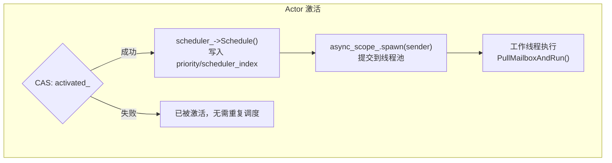

### 步骤 7：消息执行与 Coroutine 恢复

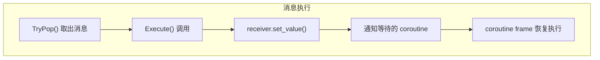

## Scheduler 调度器层次

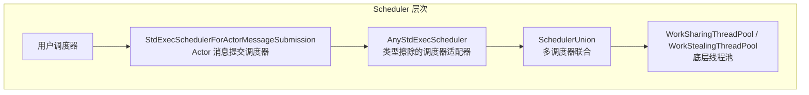

## 关键设计点

### 1. 两层调度分离

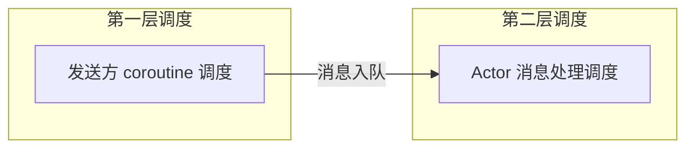

- **第一层**：调用方 coroutine 通过 `StdExecSchedulerForActorMessageSubmission` 提交消息
- **第二层**：Actor 的 scheduler 将 Actor 调度到线程池执行消息

### 2. Mailbox 批处理

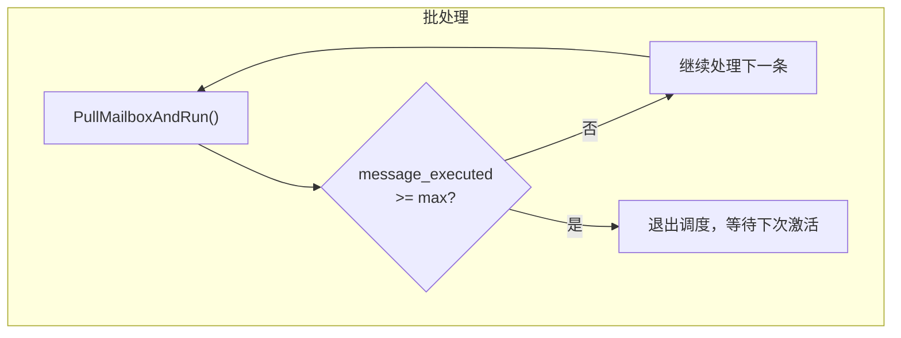

### 3. 调度器亲和性

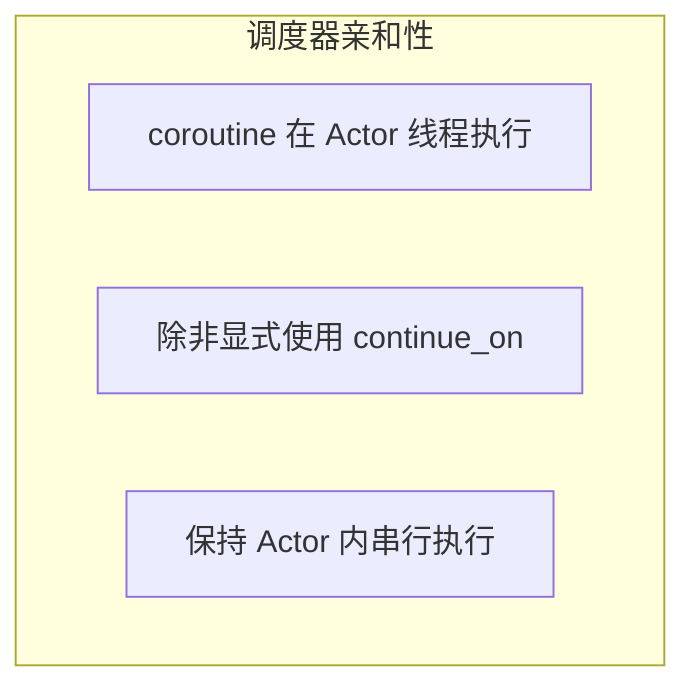

## 核心组件说明

| 组件 | 说明 |
|------|------|
| **Actor** | 用户定义的 Actor 类，包含业务逻辑方法 |
| **ActorRef** | Actor 的引用句柄，用于发送消息，支持本地/远程调用 |
| **Mailbox** | 使用 MPSC 队列存放待处理消息，保证线程安全 |
| **Scheduler** | 将 Actor 调度到线程池执行，支持优先级调度 |
| **ActorRegistry** | 管理所有 Actor 的创建、查找和销毁 |
| **MessageBroker** | 处理分布式通信，通过 ZMQ 进行节点间消息传递 |

## 关键特性

1. **异步消息传递**：使用 `std::execution` sender/receiver 模式
2. **Coroutine 支持**：Actor 方法可以是 `exec::task<T>` 返回异步结果
3. **批量处理**：每个 Actor 单次激活可处理多条消息（`max_message_executed_per_activation`）
4. **优先级调度**：支持基于优先级的消息处理
5. **分布式支持**：跨节点 Actor 引用，透明序列化/反序列化
