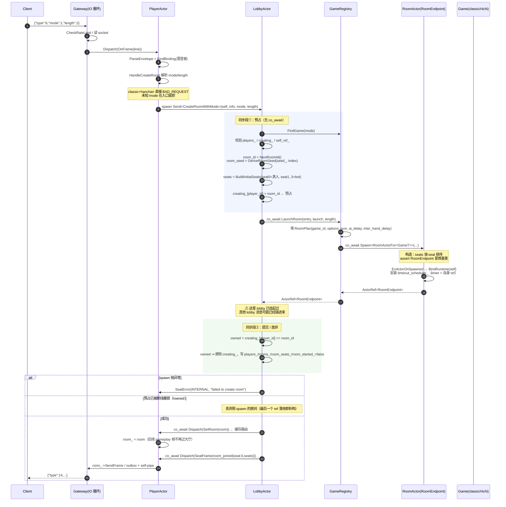
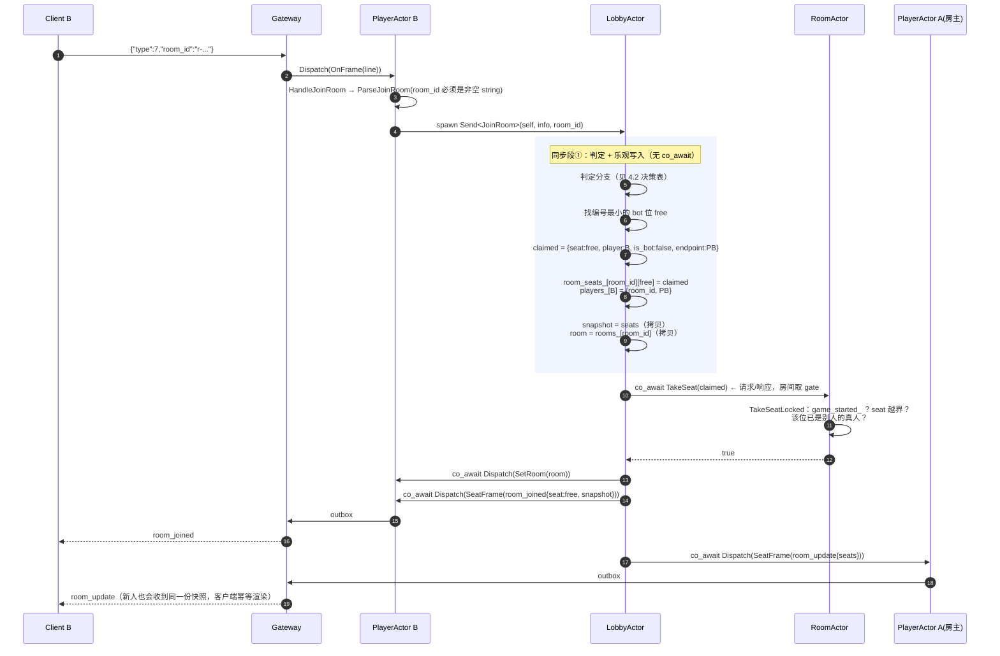
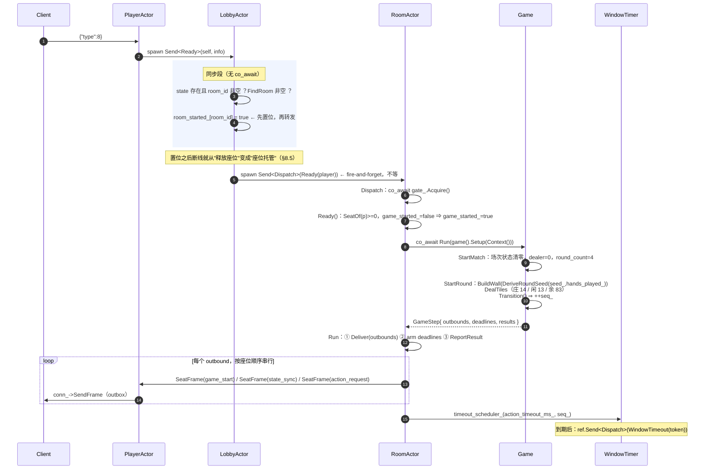

# 建房 → 入房 → 开局：全链路时序分析

> 入口：`game/server/lobby.cc:382`（`LobbyActor::JoinRoom`）
> 覆盖面：`create_room` / `join_room` / `ready` 三条线上帧，从 TCP 帧进来到第一手 `action_request` 发出为止。
> 对应协议：`PROTOCOL.md` §4.2 create_room、§4.3 join_room、§4.4 ready、§5.3 room_joined、§5.17 room_update、§5.4 game_start。

---

## 1. 参与者与执行上下文

| 参与者 | 代码位置 | 执行上下文 | 职责 |
| --- | --- | --- | --- |
| Client | — | 外部进程 | 发 JSON 行帧 |
| Gateway | `gateway.cc` | **单线程** I/O 循环（epoll/kqueue） | 读写 socket、限流、把帧塞进 PlayerActor 邮箱、刷出 outbox |
| `Connection` | `connection.h` | 任意线程可写（mutex + outbox） | 每个连接一个出站缓冲，网关循环负责 flush |
| `PlayerActor` | `player_actor.cc` | actor 池 | 协议入口：解析帧、登录门禁、路由；同时是 `SeatEndpoint`（房间/大厅的帧都投给它） |
| `LobbyActor` | `lobby.cc` | actor 池（**单 mailbox，无 gate**） | 玩家→房间映射、房间注册表、等待页座位镜像 |
| `RoomActor` | `room_actor.cc`（`RoomActorFor<GameT>`） | actor 池（**有 `AsyncGate`**） | 牌桌外壳：座位、投递、一次性 deadline、结算上报 |
| `Game` | `classic/…`、`riichi/…` | 在 RoomActor 内被调用 | 规则、发牌、帧构造、bot 策略 |
| `WindowTimer` | `timer.h` | **独立定时线程** | 到期把 token 作为消息投回房间 |
| `DbActor` | `db.h` | 独立单线程池 | 账号/战绩落库（本文只在结算处提及） |

三条关键结构约束：

1. **一个 actor 同时只有一个 activation**。框架在 handler 第一次 `co_await` 挂起后，就把下一条消息交给同一 actor 执行（`include/ex_actor/internal/actor.h:359-387` 的 `PullMailboxAndRun` 循环）。
2. 因此 **跨挂起的临界区必须自己保护**：`RoomActor` 用 `AsyncGate` 覆盖 `Dispatch`/`TakeSeat`；`LobbyActor` 不需要 gate，因为它所有注册表访问都在**同步段**里，跨 `co_await` 的只有"协议"而不是"临界区"（`lobby.h:2-14`）。
3. **actor 从不直接写别的 actor 的状态**，只投消息。房间只知道 `ActorRef<SeatEndpoint>`，大厅只知道 `ActorRef<RoomEndpoint>`。

---

## 2. 阶段 0：前置条件（一次登录）

建房/入房都要求 `session_.logged_in()`（`player_actor.cc:174-178`）。游客登录是同步的：`LoginAsGuest` 直接回 `login_ok`。账号登录是异步的：`DbActor` 回包后走 `LobbyActor::OnLoggedIn`，由大厅判定 `in_room`（`lobby.cc:510`）。**本文从"已登录、`in_room=false`"开始。**

---

## 3. 阶段 1：`create_room`（建一个 1 真人 + 3 AI 的等待室）

### 3.1 时序图



### 3.2 关键点

**① 预占（`creating_`）是跨挂起唯一的不变量。**
`LaunchRoom` 里的 `co_await Spawn<...>` 会让 lobby 挂起，此时同一玩家可能：再发一次 `create_room`，或者 socket 直接断（`OnConnectionClosed → DropPlayer` 会 `creating_.erase`）。两者都不能"和正在 spawn 的这次一起成功"，所以：

- 第二发 `create_room` 在同步段①就看到 `creating_.contains()` → `BAD_REQUEST "already in a room"`；
- 断线把预占擦掉后，spawn 回来的同步段②发现 `owned == false`，**不注册**这个房间，直接丢弃（`lobby.cc:278-283`）。已 spawn 的 actor 不会泄漏：`room` 是最后一个 `ActorRef`，出作用域即析构。

**② `room_id` 与牌山种子的确定性。**
`room_id = "r-" + 13 位 base36`，位布局 `36 bit 随机 tag | 28 bit 递增序号`（`lobby.cc:20-50`）。tag 每个 `LobbyActor` 抽一次，用来跨重启/多进程保唯一（`match_results` 以 `(room_id, account_id)` 为唯一键，复用 id 会把新场次误判成重复写入）。种子是纯函数 `DeriveRoomSeed(seed_, room_index)`，所以 `--seed` 固定时整场可逐帧复现。**房间种子只管房间之间不同**，局与局之间由 `DeriveRoundSeed` 负责（见阶段 3）。

**③ 房间在 spawn 完成时就已"满员"。**
座位 1..3 一开始就是 bot（`AI-1..AI-3`），房间从不处于"人不够"的状态——这正是 `ready` 能"一个人就开局"的原因，也是 `join_room` 只是"把某个 bot 位换成人"的原因。

**④ 建房的应答只有一帧 `room_joined`，没有 `room_update`。**
此刻房间里只有 seat 0 一个人，没有别的真人需要广播（对比阶段 2）。

---

## 4. 阶段 2：`join_room`（`lobby.cc:382`）

### 4.1 时序图（成功路径）



### 4.2 判定决策表（`lobby.cc:391-428`）

顺序敏感，先命中先返回：

| # | 条件 | 结果 |
| --- | --- | --- |
| 1 | `creating_` 里有该 player | `BAD_REQUEST` `"already in a room"` |
| 2 | `players_[p].room_id == room_id` | **幂等重入**：重发一帧当前 `room_joined`，状态不变（`same_room`），不碰房间 |
| 3 | `players_[p].room_id` 非空且是别的房 | `BAD_REQUEST` `"already in a room"` |
| 4 | 房间不存在，或 `room_started_[room_id] == true` | `ROOM_NOT_FOUND`（`"room already started"` / `"no such room: ..."`） |
| 5 | 找不到 bot 位（四席全真人） | `ROOM_NOT_FOUND` `"room is full"` |
| 6 | 其余 | 取**编号最小**的 bot 位，进入乐观写入 |

注意第 4 条用 `find` 而不是 `operator[]`：`room_started_` 上的 `operator[]` 会把"不存在的房间"插入成"未开局"，污染后续 `ListRooms` 与第 4 条自身。

### 4.3 乐观写入 + 回滚

大厅先改自己的镜像（`room_seats_`)和映射（`players_`），**再去问房间要不要**。房间是座位的事实权威，它可能已经 `game_started_`（大厅的 `room_started_` 还没被别的路径更新，或存在竞态窗口）。被拒时逐项回滚（`lobby.cc:446-458`）：

```text
players_.erase(player_id)
room_seats_[room_id][seat] = bot（重建 AI-N）
ReplyError(ROOM_NOT_FOUND, "room already started")
```

### 4.4 为什么 `snapshot` / `room` 必须在挂起前拷贝

`TakeSeat` 是一个真正的 `co_await`（房间取 gate 才回答）。挂起期间 lobby 仍会处理别的消息——最危险的是 `ReapRoom`，它会 `rooms_.erase` / `room_seats_.erase`。所以：

- `snapshot`、`room` 都是**值拷贝**，不是 `room_seats_[room_id]` 的引用；
- `BroadcastRoomUpdate` 里也先把收件人 `ActorRef` 拷出来再用（`lobby.cc:143-150`），否则调用方的 roster 引用可能已悬空。

### 4.5 `room_joined` 与 `room_update`

- `room_joined`（§5.3）**只发给入座者**，带 `seat` 与四席快照；
- `room_update`（§5.17）**广播给所有仍连着线的真人**（含刚进来的人），帧里没有 per-recipient 字段，所以一份 payload 服务所有人；客户端按幂等处理"同一份快照收到两次"。

---

## 5. 阶段 3：`ready` → 开局

### 5.1 时序图



### 5.2 `GameStep` 的三条通道，且顺序被冻结

`RoomActor::Run`（`room_actor.cc:137-153`）严格按固定次序执行：

1. **先发帧**：座位必须先看见窗口，它的 deadline 才允许开跑；
2. **再 arm deadline**：`GameStep::deadlines` 是一次性的（一步只 arm 自己列的那些，漏掉即"没有定时器"，不会累积）；
3. **最后上报结算**：`results` → `ReportResult` → `RoomOwner::OnRoomFinished`。

开局这一帧的产出（classic）：

| 帧 | 收件人 | 来源 |
| --- | --- | --- |
| `game_start` | 逐座位（每人只含自己手牌） | `StartRound` 的 `EmitPerSeat` |
| `state_sync` | 逐座位 | `Pump` / `DrawForCurrentSeat` 等 |
| `action_request` | 当前该行动的真人（bot 不发） | `OpenDiscardWindow`，仅当 `SeatPresent(seat)` |
| — | — | `Arm(action_timeout_ms_, seq_)` 由 `OpenWindowTimer` 产生 |

`Pump` 会在**同一条消息内**把 bot 的行动推进到需要人类决策为止；bot 决策受 `ai_delay_ms` 节流时，会 `Arm` 一个 pacing deadline 然后 `return`，让人类帧继续被服务。

### 5.3 为什么房间必须有 gate，大厅不需要

- 房间的 `Deliver` 真的会挂起（逐个 await 四个座位的邮箱），若没有 gate，下一条消息会在"帧发到一半"时插进来，看到半更新的牌局状态。
- 大厅每个 handler 的注册表读写都在**同步段**内，挂起点之后只做投递；跨挂起要保护的是"协议"（预占、owned 复检、拷贝快照），而不是某个临界区。`AsyncGate` 用在这里没有收益。

---

## 6. 阶段 4：对局中的帧为什么不回大厅

`create_room` / `join_room` 成功时大厅都会先投 `SetRoom(room)`（`lobby.cc:290`、`lobby.cc:460`），`PlayerActor` 把它缓存成 `room_`（`player_actor.cc:64-67`）。之后 `discard` / `action` / `autoplay` 直接：

```text
PlayerActor::OnFrame → HandleDiscard → room_.Send<Dispatch>(GameFrame(player, frame))
```

—— **不经过 LobbyActor**。这不只是性能：大厅一旦挂起在别人的 `create_room` 里，经过它的帧会被阻塞。

### 超时与结算路径

| 触发 | 路径 |
| --- | --- |
| 行动窗口到期 | `WindowTimer` 线程 → `Schedule` 回调 → `room.Send<Dispatch>(WindowTimeout(token))` → `OnTimeout` → `game().OnTimeout(token)`；`seq` 已前进则该 token 被静默丢弃（§0.5） |
| 一局结束 | `Run` 的 `results` → `ReportResult` → `owner_.Send<OnRoomFinished>` → 大厅写 `match_results` 行（每局写） |
| 整场结束 | `settlement.match_over` ⇒ 大厅 `timer_->Schedule(30000, ReapRoom(room_id))`（`lobby.cc:341-348`） |
| 回收 | `ReapRoom`：先同步删注册表 → 再逐个 `Close` 连接；最后一个 `ActorRef<RoomEndpoint>` 落地即销毁 RoomActor |

---

## 7. 异常与并发路径

| 场景 | 发生点 | 行为 |
| --- | --- | --- |
| 建房中再发 `create_room` | spawn 挂起期间 | `creating_` 命中 → `BAD_REQUEST`，只成一个房间（`lobby_test.cc:271 PipelinedCreateRoomKeepsOneRoomPerPlayer`） |
| 建房中连接断开 | `OnConnectionClosed → DropPlayer` 擦 `creating_` | spawn 回来后 `owned==false`，不注册、丢弃房间（`lobby_test.cc:301`） |
| 入房时房间已开局 | `TakeSeat` 返回 `false` | 回滚 `players_`、座位还原为 bot、`ROOM_NOT_FOUND` |
| 入房者未开局就断线 | `DropPlayer`（`room_started_==false`） | 座位还原为 bot，`room.Send<TakeSeat>(bot)`，广播 `room_update`（§4.3） |
| 房主（seat 0）断线 | 同上 | 整个房间从注册表删除，**不发** `room_update`（房间已不存在） |
| 开局后断线 | `room_started_==true` | 座位**托管**：`room.Send<Dispatch>(PlayerDisconnected(player, old_conn))`，对局继续（§8.5） |
| 旧连接的迟到关闭 | `DropPlayer(force=false)` | `players_[p].conn != conn` ⇒ 空操作，不会把重连的新座位再置托管 |
| 断线落在行动窗口内 | `OnPlayerDisconnected` | 窗口**不代打**，倒计时照走；窗口内重连仍拥有决策权 |
| 重连（账号 login 带 resume） | `OnLoggedIn` | 只有"已开局"的房间可恢复：回 `login_ok{in_room:true}` → `room_joined` → `SetRoom` → `RoomEnvelope::Reconnected`（重放 `game_start` + `state_sync`，且不刷新 deadline） |

---

## 8. 不变量清单（改动这些代码前请先确认它们仍然成立）

1. **一个玩家最多一个房间**：`players_` ∪ `creating_` 的两处门禁覆盖了"已提交"和"正在提交"两种状态。
2. **房间是座位的事实权威，大厅只是镜像**：任何 `room_seats_` 的写入都必须能回滚，或以 `TakeSeat` 的成功为前提。
3. **跨挂起只带值，不带引用**：`snapshot`、`room`、`recipients` 都是拷贝。
4. **先 `SetRoom` 再回 `room_joined`**：同一 `PlayerActor` 邮箱的有序性保证客户端不会在还没有房间路由时就先看到入房成功。
5. **`room_started_` 先置位，`Ready` 后投递**：置位之后的断线语义立即切换为"托管"。
6. **`room_joined` 只给本人，`room_update` 给所有真人**；`room_update` 无 per-recipient 字段，一份 payload 广播。
7. **房间帧的发送顺序固定为：帧 → deadline → 结算上报。**
8. **种子分两层**：房间层 `DeriveRoomSeed`，局层 `DeriveRoundSeed`；缺任一层会导致整场每局牌山相同。

---

## 9. 代码索引

| 主题 | 位置 |
| --- | --- |
| 帧分发入口 | `gateway.cc:532` `DispatchFrame` |
| 协议路由表 | `player_agent.h:78-93` `kLobbyFrameBindings` / `kRoomFrameBindings` |
| 建房参数解析 | `player_lobby_agent.cc:22-59` `HandleCreateRoom` |
| 建房主体 | `lobby.cc:182-292` `CreateRoomWithMode` |
| 入房主体 | `lobby.cc:382-465` `JoinRoom` |
| 开局 | `lobby.cc:467-489` `Ready` |
| 房间 id / 种子 | `lobby.cc:20-50`、`room_contract.h:66-92` |
| 玩法注册表 | `game_registry.cc:55-58`、`79-92` `LaunchRoom` |
| 房间外壳入口 | `room_actor.cc:94` `Dispatch`、`115` `TakeSeat`、`137` `Run` |
| 房间开局 | `room_actor.cc:268-280` `Ready` |
| 发牌 | `classic/classic_mahjong_game.cc:658` `StartMatch`、`675` `StartRound`、`732` `Pump` |
| 座位到连接 | `player_actor.cc:62` `SeatFrame`、`64` `SetRoom` |
| 注册表回收 | `lobby.cc:301-348` `OnRoomFinished`、`640` `ReapRoom` |
| 断线/托管 | `lobby.cc:572-632` `DropPlayer` |
